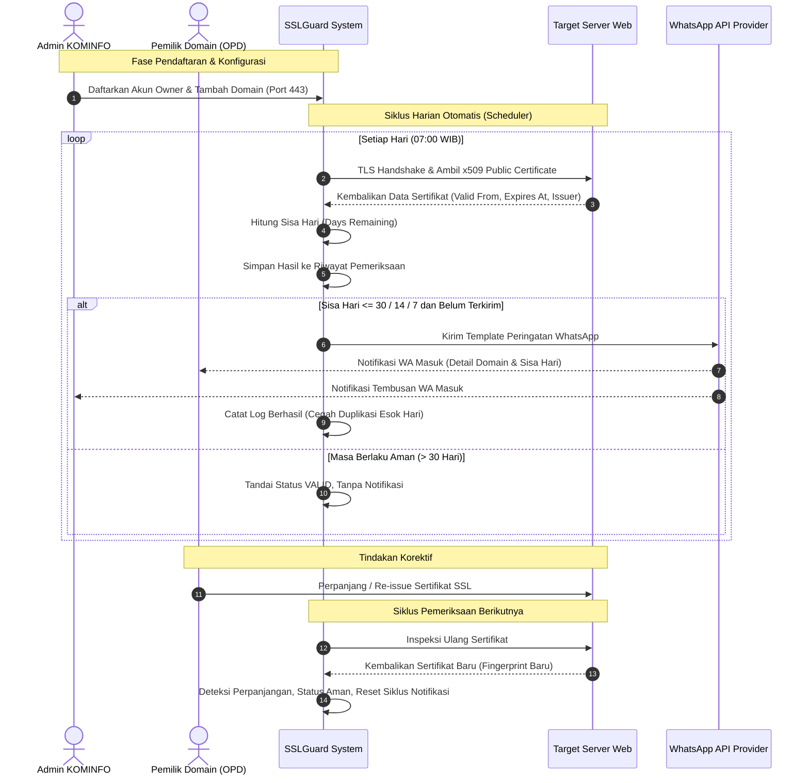

# BUSINESS REQUIREMENTS DOCUMENT (BRD)
## DOKUMEN KEBUTUHAN BISNIS
# **SSLGUARD: SSL Certificate Monitoring & WhatsApp Alert System**

**Nomor Dokumen:** BRD-SSLGUARD-2026-001  
**Versi:** 1.0  
**Tanggal Terbit:** Oktober 2026  
**Status:** Disetujui (Approved)  
**Pemilik Proyek (Project Sponsor):** Dinas Komunikasi dan Informatika (KOMINFO)  
**Penyusun:** Tim Pengembang PKL 2026 - KOMINFO  

---

## DAFTAR ISI
1. [RINGKASAN EKSEKUTIF (EXECUTIVE SUMMARY)](#1-ringkasan-eksekutif-executive-summary)
2. [LATAR BELAKANG DAN TUJUAN BISNIS](#2-latar-belakang-dan-tujuan-bisnis)
   - 2.1 Konteks Masalah (*Problem Statement*)
   - 2.2 Dampak Bisnis dari Permasalahan (*Business Impact*)
   - 2.3 Tujuan Proyek (*Business Objectives*)
   - 2.4 Indikator Kinerja Utama (*Key Performance Indicators / KPIs*)
3. [ANALISIS PEMANGKU KEPENTINGAN (STAKEHOLDER ANALYSIS)](#3-analisis-pemangku-kepentingan-stakeholder-analysis)
4. [ANALISIS KONDISI SAAT INI VS KONDISI MASA DEPAN (CURRENT VS FUTURE STATE)](#4-analisis-kondisi-saat-ini-vs-kondisi-masa-depan)
   - 4.1 Proses Bisnis Saat Ini (*As-Is Process*)
   - 4.2 Proses Bisnis Masa Depan (*To-Be Process*)
   - 4.3 Diagram Alur Bisnis (*BPMN / Swimlane Diagram*)
5. [RUANG LINGKUP BISNIS (BUSINESS SCOPE)](#5-ruang-lingkup-bisnis-business-scope)
   - 5.1 Lingkup Termasuk (*In-Scope*)
   - 5.2 Lingkup Tidak Termasuk (*Out-of-Scope*)
   - 5.3 Rencana Pengembangan Lanjutan (*Future Roadmap*)
6. [KEBUTUHAN BISNIS DAN ATURAN BISNIS (BUSINESS REQUIREMENTS & RULES)](#6-kebutuhan-bisnis-dan-aturan-bisnis)
   - 6.1 Daftar Kebutuhan Bisnis (*Business Requirements*)
   - 6.2 Aturan Bisnis (*Business Rules*)
7. [ANALISIS MANFAAT DAN BIAYA (COST-BENEFIT ANALYSIS)](#7-analisis-manfaat-dan-biaya)
   - 7.1 Manfaat Kualitatif & Kuantitatif
   - 7.2 Komponen Biaya Operasional
8. [ANALISIS RISIKO BISNIS DAN MITIGASI](#8-analisis-risiko-bisnis-dan-mitigasi)
9. [KRITERIA PENERIMAAN BISNIS (BUSINESS ACCEPTANCE CRITERIA)](#9-kriteria-penerimaan-bisnis)

---

## 1. RINGKASAN EKSEKUTIF (EXECUTIVE SUMMARY)

Layanan publik pemerintah dan institusi modern sangat bergantung pada ketersediaan website dan aplikasi berbasis web. Seluruh portal layanan tersebut diwajibkan menggunakan enkripsi data berbasis sertifikat keamanan digital SSL/TLS (*Secure Sockets Layer / Transport Layer Security*) dengan protokol HTTPS. Namun, sertifikat SSL/TLS memiliki batas masa berlaku terbatas (biasanya 90 hari untuk Let's Encrypt atau 365 hari untuk SSL komersial).

Keterlambatan dalam memperbarui sertifikat SSL menyebabkan peramban (*browser*) memunculkan peringatan keras keamanan (*"Your connection is not private"*), pemblokiran akses masyarakat ke layanan publik, serta penurunan drastis tingkat kepercayaan publik terhadap kredibilitas institusi.

**SSLGuard** hadir sebagai inisiatif solusi strategis berupa platform terpusat (*centralized platform*) yang memantau secara proaktif masa kedaluwarsa seluruh domain dan subdomain instansi. Sistem ini secara otomatis mengirimkan peringatan berjenjang langsung ke saluran komunikasi harian para pengelola, yaitu **WhatsApp**, pada **H-30, H-14, dan H-7** sebelum sertifikat habis masa berlakunya. Dengan SSLGuard, risiko kelalaian manusia (*human error*) dapat diminimalisasi hingga 0%, memastikan kelangsungan operasional (*business continuity*) layanan digital KOMINFO.

---

## 2. LATAR BELAKANG DAN TUJUAN BISNIS

### 2.1 Konteks Masalah (*Problem Statement*)
1. **Desentralisasi Pengelolaan Domain:** Instansi mengelola puluhan hingga ratusan domain dan subdomain untuk berbagai Organisasi Perangkat Daerah (OPD), dinas, atau unit kerja. Masing-masing domain dikelola oleh admin/unit teknis yang berbeda-beda.
2. **Pencatatan Masih Manual:** Sebagian besar pengelola masih mengandalkan pengingat kalender manual, spreadsheet, atau baru menyadari sertifikat kedaluwarsa setelah ada keluhan dari masyarakat/pimpinan.
3. **Email Sering Terlewat (*Notification Fatigue*):** Notifikasi otomatis bawaan dari penyedia SSL (seperti Let's Encrypt atau penyedia hosting) biasanya dikirim melalui email, yang sering kali masuk ke folder *Spam*, terabaikan di kotak masuk yang padat, atau dikirim ke email pegawai yang sudah tidak aktif/mutasi.
4. **Ketidaksesuaian Notifikasi:** Tidak adanya mekanisme yang memisahkan antara pengelola teknis domain (*Owner*) dengan pimpinan pemantau infrastruktur pusat (*Admin KOMINFO*).

### 2.2 Dampak Bisnis dari Permasalahan (*Business Impact*)
| Aspek Dampak | Dampak Nyata Tanpa Sistem Terpusat |
| :--- | :--- |
| **Reputasi Instansi** | Munculnya persepsi negatif publik bahwa portal pemerintah diretas (*hacked*) atau tidak aman saat muncul layar merah peringatan browser. |
| **Layanan Publik Terhenti** | Masyarakat dan instansi lain tidak dapat melakukan transaksi elektronik atau mengakses informasi penting. |
| **Penurunan Peringkat SEO & Kepercayaan** | Mesin pencari (Google) menurunkan peringkat pencarian situs yang bermasalah dengan sertifikat keamanan. |
| **Beban Kerja Reaktif IT** | Tim teknis harus menangani insiden secara darurat (*firefighting*) di luar jam kerja dengan tekanan tinggi. |

### 2.3 Tujuan Proyek (*Business Objectives*)
1. **Zero Unplanned Outage:** Menghilangkan 100% insiden website mati/insecure akibat sertifikat SSL yang lupa diperpanjang.
2. **Sentralisasi Inventaris:** Memusatkan inventaris status keamanan seluruh domain binaan KOMINFO dalam satu *single pane of glass dashboard*.
3. **Efisiensi Saluran Komunikasi:** Memanfaatkan WhatsApp sebagai media peringatan tercepat dan memiliki tingkat keterbacaan (*open rate*) tertinggi di Indonesia (>95%).
4. **Transparansi & Akuntabilitas:** Menyediakan log audit resmi mengenai kapan domain dicek, kapan notifikasi dikirim, dan siapa penanggung jawab unit yang telah dihubungi.

### 2.4 Indikator Kinerja Utama (*Key Performance Indicators / KPIs*)
- **KPI-01 (Insiden SSL):** 0 insiden website kedaluwarsa tanpa terdeteksi sebelumnya.
- **KPI-02 (Tingkat Keterbacaan Peringatan):** 100% peringatan H-30, H-14, dan H-7 terkirim sukses ke nomor WhatsApp penanggung jawab.
- **KPI-03 (Waktu Respons Perpanjangan):** Penurunan rata-rata waktu pembaruan sertifikat menjadi maksimal H-5 sebelum tanggal habis berlaku.
- **KPI-04 (Efisiensi Audit):** Waktu pembuatan rekap laporan bulanan berkurang dari 2 hari kerja menjadi sekali klik ekspor data (< 5 detik).

---

## 3. ANALISIS PEMANGKU KEPENTINGAN (STAKEHOLDER ANALYSIS)

| Pemangku Kepentingan | Peran / Jabatan | Kebutuhan & Ekspektasi Bisnis |
| :--- | :--- | :--- |
| **Kepala Dinas / Pimpinan KOMINFO** | *Project Sponsor / Executive* | - Kepastian layanan portal daerah aman dan bebas peringatan keamanan. - Laporan ringkas status kesehatan domain secara berkala. - Menghindari komplain publik dan pimpinan daerah. |
| **Admin Infrastruktur & Keamanan Informasi (KOMINFO)** | *System Administrator / Core User* | - Dashboard terpusat untuk memantau semua domain tanpa perlu cek manual satu per satu. - Mendapat notifikasi tembusan saat ada domain OPD yang mendekati kedaluwarsa. - Kemudahan mengidentifikasi pemilik domain yang belum memperpanjang sertifikat. |
| **Penanggung Jawab Unit Kerja / OPD (Website Owner)** | *Domain Owner / Secondary User* | - Mendapatkan peringatan langsung di WhatsApp pribadi/dinas tanpa perlu membuka dashboard setiap hari. - Peringatan yang jelas dan tidak membingungkan (disertai batas tanggal pasti). - Hanya mengurusi domain milik instansi/unitnya sendiri. |
| **Masyarakat Pengguna Layanan** | *Beneficiary (Penerima Manfaat)* | - Akses layanan web pemerintah selalu lancar, aman, dan tanpa hambatan keamanan peramban. |
| **Tim Pengembang & QA PKL** | *Implementation Team* | - Panduan kebutuhan yang jelas, ruang lingkup realistis untuk diselesaikan dalam periode proyek, dan arsitektur yang teruji. |

---

## 4. ANALISIS KONDISI SAAT INI VS KONDISI MASA DEPAN

### 4.1 Proses Bisnis Saat Ini (*As-Is Process*)
1. Pendaftaran domain dilakukan secara terpisah oleh masing-masing unit/OPD.
2. Tidak ada jadwal audit SSL terpadu; staf mengecek hanya saat teringat atau saat membuat laporan tahunan.
3. Notifikasi dari CA (*Certificate Authority*) dikirim ke email pembuat domain terdahulu (yang sering kali sudah pindah tugas/mutasi).
4. **Insiden Terjadi:** Sertifikat kedaluwarsa -> Pengguna melaporkan bahwa web tidak bisa diakses -> Tim IT panik mencari tahu akun registrar/server mana yang memegang sertifikat -> Proses perbaikan memakan waktu berjam-jam hingga berhari-hari.

### 4.2 Proses Bisnis Masa Depan (*To-Be Process*)
1. Seluruh domain didaftarkan ke sistem **SSLGuard** dengan data pemilik yang jelas dan nomor WhatsApp aktif.
2. Sistem secara otomatis menjalankan *SSL Checker Engine* setiap pagi.
3. Sistem mendeteksi sisa hari masa berlaku dan membandingkannya dengan aturan bisnis ambang H-30, H-14, dan H-7.
4. Sistem memeriksa apakah notifikasi ambang tersebut sudah pernah dikirim ke pemilik dan admin:
   - Jika **sudah**, sistem mencatat pemeriksaan tanpa mengirim ulang pesan (mencegah *spam*).
   - Jika **belum**, sistem otomatis menembakkan pesan WhatsApp resmi ke pemilik dan admin.
5. Pemilik domain melakukan perpanjangan sertifikat di servernya.
6. Pada pengecekan harian berikutnya, SSLGuard mendeteksi sidik jari sertifikat baru (*renewed*), memperbarui status menjadi **Valid**, dan mereset siklus peringatan untuk tahun/periode berikutnya.

### 4.3 Diagram Alur Bisnis (*BPMN / Swimlane Diagram*)

---

## 5. RUANG LINGKUP BISNIS (BUSINESS SCOPE)

### 5.1 Lingkup Termasuk (*In-Scope*)
1. **Manajemen Akun Berjenjang:**
   - Hak akses Administrator (Full Control, semua domain).
   - Hak akses Website Owner (Hanya domain miliknya).
2. **Pemeriksaan Sertifikat Otomatis & Terjadwal:**
   - Inspeksi koneksi HTTPS, tanggal aktif, tanggal habis tempo, penerbit (CA), kecocokan nama domain (*hostname match*), dan rantai sertifikat.
   - Pengecekan *on-demand* (manual trigger) via dashboard.
3. **Mesin Notifikasi WhatsApp Berbasis Aturan:**
   - Pemicu pada H-30 (Peringatan Awal), H-14 (Peringatan Lanjutan), dan H-7 (Peringatan Kritis/Prioritas Tinggi).
   - Jalur pengiriman terpisah untuk Owner dan Admin.
4. **Pencegahan Notifikasi Duplikat (*Idempotent Deduplication*):**
   - Menjamin pengguna tidak menerima pesan berulang setiap hari pada ambang yang sama.
5. **Dashboard Analitik & Rekap:**
   - Ringkasan status inventaris domain, riwayat audit inspeksi, log status pesan WhatsApp, dan ekspor laporan ke berkas CSV.

### 5.2 Lingkup Tidak Termasuk (*Out-of-Scope*)
1. **Perpanjangan Sertifikat Otomatis:** Sistem tidak melakukan instalasi sertifikat baru ke server web target karena membutuhkan akses root/SSH server masing-masing OPD yang berada di luar kendali SSLGuard.
2. **Audit Kerentanan Aplikasi (*Pentest*):** Sistem tidak memindai celah keamanan web seperti SQL Injection, XSS, atau miskonfigurasi aplikasi.
3. **Penyimpanan Kunci Privat:** Sistem tidak meminta, menyimpan, atau mengelola *Private Key* pengguna.
4. **SMS Gateway / Email Fallback (Tahap 1):** Pada versi MVP, notifikasi difokuskan secara eksklusif ke WhatsApp Cloud API.

### 5.3 Rencana Pengembangan Lanjutan (*Future Roadmap*)
- **Fase 2:** Integrasi dengan bot interaktif Telegram/WhatsApp (bisa balas pesan untuk cek status).
- **Fase 3:** Integrasi webhook ke platform kerja tim internal (Discord / Slack / Microsoft Teams).
- **Fase 4:** Auto-healing / ACME DNS-challenge runner bagi server yang berada di bawah kendali langsung data center KOMINFO.

---

## 6. KEBUTUHAN BISNIS DAN ATURAN BISNIS

### 6.1 Daftar Kebutuhan Bisnis (*Business Requirements*)

| ID Kebutuhan | Nama Kebutuhan | Deskripsi Bisnis | Prioritas |
| :--- | :--- | :--- | :--- |
| **BR-01** | **Inventaris Domain Terpusat** | Sistem harus mampu mencatat seluruh domain dan subdomain yang dikelola instansi secara terstruktur beserta penanggung jawabnya. | *Must Have* (Kritis) |
| **BR-02** | **Inspeksi Integritas SSL** | Sistem harus mampu memeriksa keabsahan sertifikat SSL domain secara non-intrusif tanpa membebani server target. | *Must Have* (Kritis) |
| **BR-03** | **Peringatan WhatsApp Multi-Level** | Sistem harus mengirimkan peringatan ke WhatsApp pada batas H-30, H-14, dan H-7 kepada pemilik domain dan pengawas pusat. | *Must Have* (Kritis) |
| **BR-04** | **Anti-Spam & Deduplikasi Pesan** | Sistem tidak boleh mengirimkan pesan yang sama berulang kali yang dapat mengganggu kenyamanan pengguna (*user disturbance*). | *Must Have* (Kritis) |
| **BR-05** | **Pemberitahuan Status Jaringan Objektif** | Sistem harus mampu membedakan situs yang tidak dapat diakses karena jaringan down dengan situs yang sertifikatnya kedaluwarsa. | *Must Have* (Kritis) |
| **BR-06** | **Pelaporan dan Auditability** | Sistem harus mendokumentasikan seluruh riwayat pengecekan dan pengiriman pesan sehingga dapat dipertanggungjawabkan saat audit berkala. | *Should Have* (Penting) |
| **BR-07** | **Pemeriksaan Mandiri (On-Demand)** | Pengelola harus dapat melakukan pemeriksaan seketika setelah memperpanjang sertifikat untuk memastikan pembaruan telah terbaca. | *Should Have* (Penting) |

### 6.2 Aturan Bisnis (*Business Rules*)

| Kode Aturan | Nama Aturan | Pernyataan Aturan Bisnis |
| :--- | :--- | :--- |
| **BR-RULE-01** | **Ambang Peringatan Kedaluwarsa** | Peringatan WhatsApp dipicu tepat saat sisa hari masa berlaku sertifikat berada pada ambang batas:  • **H-30:** Masa berlaku 15 s.d. 30 hari. • **H-14:** Masa berlaku 8 s.d. 14 hari. • **H-7:** Masa berlaku 0 s.d. 7 hari. |
| **BR-RULE-02** | **Aturan Idempotensi (Satu Pesan Per Siklus)** | Satu siklus sertifikat (diidentifikasi dari *SHA-256 Fingerprint*) hanya boleh memicu tepat **satu pesan notifikasi per ambang batas per penerima**. |
| **BR-RULE-03** | **Aturan Perpanjangan (Renewal Reset)** | Apabila sidik jari sertifikat pada domain berubah dan tanggal kedaluwarsa bertambah, sistem wajib menandai sertifikat telah diperpanjang dan mereset status notifikasi untuk siklus baru. |
| **BR-RULE-04** | **Aturan Kegagalan Koneksi** | Jika koneksi ke domain gagal akibat DNS tidak ditemukan atau batas waktu habis (*timeout*), status dicatat sebagai `FAILED`. Sistem **dilarang keras** mengirim notifikasi kedaluwarsa (*false alarm*). |
| **BR-RULE-05** | **Format Kontak Resmi** | Nomor WhatsApp pengguna wajib menggunakan format penomoran internasional E.164 (diawali kode negara, contoh: `+6281234567890`) agar dapat diproses oleh WhatsApp API. |
| **BR-RULE-06** | **Pemisahan Hak Akses Data** | Website Owner hanya berhak melihat daftar domain dan riwayat pemeriksaan yang didaftarkan atas akun miliknya. Admin memiliki visibilitas global. |

---

## 7. ANALISIS MANFAAT DAN BIAYA (COST-BENEFIT ANALYSIS)

### 7.1 Manfaat Kualitatif & Kuantitatif

#### A. Kuantitatif (Dapat Diukur):
- **Penghematan Waktu Audit:** Pengurangan 95% waktu staf IT yang sebelumnya dihabiskan untuk memeriksa puluhan domain secara manual setiap minggu.
- **Biaya Pemulihan Insiden:** Menghilangkan biaya operasional tak terduga yang timbul akibat penanganan insiden darurat di luar jam kerja.
- **Peningkatan SLA Layanan:** Membantu pencapaian target ketersediaan layanan digital pemerintah (*Service Level Agreement*) mendekati 99.9%.

#### B. Kualitatif (Strategis):
- **Menjaga Reputasi & Citra Pemerintah:** Menghilangkan kekhawatiran dan keluhan publik terkait peringatan situs tidak aman.
- **Kenyamanan Kerja Tim:** Tim IT bekerja secara proaktif terencana, bukan reaktif panik.
- **Pemberdayaan Unit Kerja:** Unit kerja (OPD) memiliki kesadaran lebih tinggi terhadap aset digital yang mereka kelola.

### 7.2 Komponen Biaya Operasional (Estimasi Ringan)
- **Biaya Server / Hosting:** Memanfaatkan infrastruktur server internal KOMINFO yang sudah tersedia (*Zero Additional Hardware Cost*).
- **Biaya WhatsApp API:** Menggunakan kuota percakapan WhatsApp Business Platform (terdapat alokasi gratis percakapan *Service Conversation* dari Meta untuk pesan tertentu, atau biaya sangat terjangkau per template notifikasi utilitas).

---

## 8. ANALISIS RISIKO BISNIS DAN MITIGASI

| ID Risiko | Deskripsi Risiko Bisnis | Dampak | Probabilitas | Rencana Mitigasi |
| :--- | :--- | :--- | :--- | :--- |
| **RSK-01** | **Nomor WhatsApp Owner Salah/Tidak Aktif** | Tinggi | Sedang | - Mewajibkan fitur uji coba kirim pesan (*Test Notification*) saat pendaftaran akun. - Peringatan tembusan selalu masuk ke Admin KOMINFO sebagai cadangan. |
| **RSK-02** | **Pesan Dianggap Spam oleh WhatsApp** | Tinggi | Rendah | - Menggunakan template pesan utilitas resmi (*Utility Template*) yang telah disetujui pihak Meta. - Menerapkan aturan deduplikasi ketat agar tidak ada pengiriman berulang. |
| **RSK-03** | **False Alarm Akibat Gangguan ISP / Jaringan** | Sedang | Sedang | - Menerapkan aturan bisnis BR-RULE-04 (membedakan status gagal jaringan dengan kedaluwarsa). - Menjalankan percobaan ulang (*retry*) 3 kali sebelum mencatat kegagalan. |
| **RSK-04** | **Penyalahgunaan Sistem untuk Pemindaian Ilegal (SSRF)** | Kritis | Rendah | - Menerapkan validasi input ketat pada level sistem: memblokir domain `localhost`, IP privat `192.168.x.x`, `10.x.x.x`, dan link-local cloud. |

---

## 9. KRITERIA PENERIMAAN BISNIS (BUSINESS ACCEPTANCE CRITERIA)

Proyek sistem **SSLGuard** dinyatakan berhasil dan diterima oleh pihak sponsor apabila memenuhi kriteria berikut:

1. **Kelengkapan Fitur:** Seluruh kebutuhan bisnis berkategori *Must Have* (BR-01 s.d. BR-05) berfungsi penuh tanpa kendala.
2. **Keberhasilan Notifikasi:** Pesan peringatan terbukti masuk ke aplikasi WhatsApp ponsel penguji pada skenario uji H-30, H-14, dan H-7.
3. **Validasi Anti-Spam:** Ketika scheduler dijalankan berulang kali dalam satu hari yang sama, sistem terbukti **tidak** mengirimkan pesan WhatsApp ganda.
4. **Validasi Perpanjangan:** Ketika sertifikat pada domain diperbarui, sistem mendeteksi masa berlaku baru dan tidak lagi memunculkan peringatan.
5. **Kemudahan Pengoperasian:** Pengguna awam (OPD) dapat memahami pesan peringatan WhatsApp yang diterima dan dapat melihat status domain mereka di antarmuka web.
6. **Dokumentasi Lengkap:** Tersedianya dokumen SRS (*Software Requirements Specification*), BRD (*Business Requirements Document*), serta panduan penggunaan sistem.

---

**Lembar Pengesahan Dokumen Bisnis:**

| Disusun Oleh: | Ditinjau & Disetujui Oleh: |
| :---: | :---: |
|   _______________________________ **Tim Pengembang PKL 2026** Program Praktek Kerja Lapangan |   _______________________________ **Pembimbing Instansi / Penanggung Jawab** Dinas Komunikasi dan Informatika (KOMINFO) |
