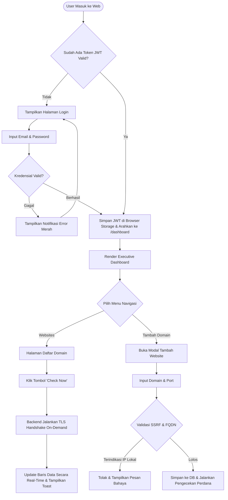

# FUNCTIONAL SPECIFICATION DOCUMENT (FSD)
## DOKUMEN SPESIFIKASI DESAIN FUNGSIONAL
# **SSLGUARD: SSL Certificate Monitoring & WhatsApp Alert System**

**Nomor Dokumen:** FSD-SSLGUARD-2026-001  
**Versi:** 1.0  
**Tanggal Terbit:** Oktober 2026  
**Status:** Disetujui (Approved)  
**Penyusun:** Tim Pengembang PKL 2026 - KOMINFO  

---

## DAFTAR ISI
1. [PENDAHULUAN](#1-pendahuluan)
   - 1.1 Tujuan Dokumen
   - 1.2 Sasaran Pembaca
   - 1.3 Hubungan dengan BRD dan SRS
2. [PETA SITUS DAN ALUR NAVIGASI (SITE MAP & NAVIGATION FLOW)](#2-peta-situs-dan-alur-navigasi)
   - 2.1 Arsitektur Informasi & Site Map
   - 2.2 Diagram Alur Pengguna (User Journey Flow)
3. [SPESIFIKASI ANTARMUKA PENGGUNA (UI/UX SPECIFICATION & WIREFRAMES)](#3-spesifikasi-antarmuka-pengguna)
   - 3.1 Layar 01: Halaman Login (Login Screen)
   - 3.2 Layar 02: Dashboard Ringkasan (Executive Dashboard)
   - 3.3 Layar 03: Manajemen Website & Tambah Domain Modal
   - 3.4 Layar 04: Detail Website & Riwayat Pemeriksaan
   - 3.5 Layar 05: Log Audit Notifikasi WhatsApp
   - 3.6 Layar 06: Manajemen Pengguna (Khusus Admin)
4. [SPESIFIKASI SKENARIO USE CASE DETAIL](#4-spesifikasi-skenario-use-case-detail)
   - 4.1 UC-01: Autentikasi Pengguna & Sesi JWT
   - 4.2 UC-02: Pendaftaran & Validasi Domain (Proteksi SSRF)
   - 4.3 UC-03: Eksekusi Pemeriksaan Manual (On-Demand SSL Check)
   - 4.4 UC-04: Eksekusi Otomatis Harian (Scheduler Engine)
   - 4.5 UC-05: Evaluasi Ambang & Deduplikasi Notifikasi WhatsApp
   - 4.6 UC-06: Ekspor Data Monitoring ke Format CSV
5. [SPESIFIKASI KONTRAK DATA & API (API PAYLOAD SPECIFICATION)](#5-spesifikasi-kontrak-data--api)
   - 5.1 Format Standar Respons API
   - 5.2 Spesifikasi Endpoint Autentikasi
   - 5.3 Spesifikasi Endpoint Website & Manual Check
   - 5.4 Spesifikasi Endpoint Log Notifikasi & Webhook Provider
6. [LOGIKA ALGORITMA & PSEUDOCODE](#6-logika-algoritma--pseudocode)
   - 6.1 Algoritma Pemeriksaan SSL & Ekstraksi x509
   - 6.2 Algoritma Evaluasi Peringatan & Kunci Deduplikasi
7. [DAFTAR KODE KESALAHAN & PESAN SISTEM (ERROR CODES & MESSAGES)](#7-daftar-kode-kesalahan--pesan-sistem)

---

## 1. PENDAHULUAN

### 1.1 Tujuan Dokumen
Dokumen *Functional Specification Document* (FSD) ini menyajikan rincian teknis-operasional mengenai *bagaimana* setiap fungsi, komponen antarmuka (*UI*), interaksi pengguna (*UX*), logika algoritma pemrosesan, dan kontrak pertukaran data API dalam sistem **SSLGuard** dirancang dan dibangun.

### 1.2 Sasaran Pembaca
- **Front-End Developer:** Sebagai panduan tata letak layar, komponen input, validasi sisi klien (*client-side validation*), penanganan error, dan integrasi API.
- **Back-End Developer:** Sebagai acuan perancangan *route handler*, algoritma soket kriptografi, aturan deduplikasi, transaksi database, dan format respons JSON.
- **QA Engineer / Software Tester:** Sebagai dasar penyusunan lembar pengujian fungsional terperinci (*test steps, expected results, boundary tests*).

### 1.3 Hubungan dengan BRD dan SRS
- **BRD (*Business Requirements Document*):** Menjelaskan *MENGAPA* sistem dibangun dan nilai bisnisnya bagi instansi KOMINFO.
- **SRS (*Software Requirements Specification*):** Menjelaskan *APA* saja kebutuhan fungsional dan batasan teknis sistem secara formal.
- **FSD (*Functional Specification Document*):** Menjelaskan *BAGAIMANA* sistem bekerja secara presisi (tampilan, alur klik per tombol, algoritma pemrosesan, payload JSON, dan pesan sistem).

---

## 2. PETA SITUS DAN ALUR NAVIGASI

### 2.1 Arsitektur Informasi & Site Map

```
+-------------------------------------------------------------+
|                         PORTAL LOGIN                        |
|                     (/login) [Akses Publik]                 |
+------------------------------+------------------------------+
                               |
                   Autentikasi Berhasil (JWT)
                               |
                               v
+-------------------------------------------------------------+
|                 MAIN APP LAYOUT (Sidebar & Header)          |
+-------------------------------------------------------------+
         |                     |                     |
         v                     v                     v
+-----------------+   +-----------------+   +-----------------+
| DASHBOARD UTAMA |   |  DAFTAR WEBSITE |   | LOG NOTIFIKASI  |
| (/dashboard)    |   |  (/websites)    |   | (/notifications)|
| - Stat Cards    |   | - Search/Filter |   | - Audit Log WA  |
| - Charts        |   | - Modal Tambah  |   | - Status Pesan  |
| - Quick Actions |   | - Tombol Check  |   | - Tes Kirim     |
+-----------------+   +--------+--------+   +-----------------+
                               |
                               v
                      +-----------------+
                      | DETAIL WEBSITE  |
                      | (/websites/:id) |
                      | - Info x509     |
                      | - Riwayat Check |
                      +-----------------+
                               |
            [Khusus Role Admin]|
                               v
                      +-----------------+
                      | KELOLA PENGGUNA |
                      | (/users)        |
                      | - List & Status |
                      | - Modal User    |
                      +-----------------+
```

### 2.2 Diagram Alur Pengguna (User Journey Flow)



---

## 3. SPESIFIKASI ANTARMUKA PENGGUNA (UI/UX SPECIFICATION & WIREFRAMES)

### 3.1 Layar 01: Halaman Login (Login Screen)
- **URL Path:** `/login`
- **Akses:** Publik (tanpa otentikasi)
- **Deskripsi:** Form otentikasi untuk Admin dan Website Owner dengan desain modern bernuansa *dark slate* elegan khas keamanan digital.

#### Wireframe Tata Letak:
```
+--------------------------------------------------------------+
|                                                              |
|                     [ Logo SSLGuard ]                        |
|               SSL Certificate Monitoring System              |
|                     KOMINFO Kabupaten/Kota                   |
|                                                              |
|        +--------------------------------------------+        |
|        |                  MASUK                     |        |
|        |                                            |        |
|        |  Email Pengguna                            |        |
|        |  [ admin@kominfo.go.id                   ] |        |
|        |                                            |        |
|        |  Kata Sandi                                |        |
|        |  [ **********************            [x] ] |        |
|        |                                            |        |
|        |  [x] Ingat Sesi Saya                       |        |
|        |                                            |        |
|        |  [             TOMBOL MASUK              ] |        |
|        +--------------------------------------------+        |
|                                                              |
|        (c) 2026 Tim PKL KOMINFO - All Rights Reserved        |
+--------------------------------------------------------------+
```

#### Spesifikasi Elemen & Validasi:
| Nama Komponen | Tipe Elemen | Validasi / Aturan | Pesan Error |
| :--- | :--- | :--- | :--- |
| `input_email` | Text Input (Email) | Wajib diisi, format email valid RFC 5322. | "Format email tidak valid" |
| `input_password` | Password Input | Wajib diisi, minimal 8 karakter. | "Kata sandi wajib diisi" |
| `btn_login` | Primary Button | Dinonaktifkan (*disabled*) saat proses kirim API berjalan (loading spinner). | - |
| `alert_box` | Toast Notification | Menampilkan pesan dari respons backend jika login gagal (HTTP 401). | "Email atau kata sandi tidak cocok" |

---

### 3.2 Layar 02: Dashboard Ringkasan (Executive Dashboard)
- **URL Path:** `/dashboard`
- **Akses:** Terotentikasi (`admin` & `owner`)
- **Deskripsi:** Menampilkan matriks ringkasan status kesehatan seluruh domain secara visual dan informatif.

#### Wireframe Tata Letak:
```
+------------------------------------------------------------------------------------+
| SSLGuard | Dashboard  Websites  Notifications  Users (Admin)     [Profil: Admin v] |
+------------------------------------------------------------------------------------+
|                                                                                    |
|  RINGKASAN STATUS MONITORING SSL                                                   |
|                                                                                    |
|  +----------------+  +----------------+  +----------------+  +------------------+  |
|  | TOTAL DOMAIN   |  | VALID & AMAN   |  | PERLU PERHATIAN|  | KRITIS & EXPIRED |  |
|  |      42        |  |      35        |  |       5        |  |        2         |  |
|  | [Semua Unit]   |  | (> 30 Hari)    |  | (H-30 / H-14)  |  | (<= 7 Hari / Exp)|  |
|  +----------------+  +----------------+  +----------------+  +------------------+  |
|                                                                                    |
|  +-------------------------------------------+  +-------------------------------+  |
|  | DOMAIN YANG MEMBUTUHKAN TINDAKAN (TOP 5)  |  | STATUS LOG NOTIFIKASI HARI INI|  |
|  +-------------------------------------------+  +-------------------------------+  |
|  | Domain              | Sisa Hari | Status  |  | Total Alert Dikirim : 4 Pesan |  |
|  |---------------------|-----------|---------|  | - H-30 Alerts       : 2 Pesan |  |
|  | portal.dinas.go.id  | 3 Hari    | KRITIS  |  | - H-14 Alerts       : 1 Pesan |  |
|  | e-office.kab.go.id  | 6 Hari    | KRITIS  |  | - H-7 Alerts        : 1 Pesan |  |
|  | layanan.kec.go.id   | 18 Hari   | WARNING |  |                               |  |
|  | jdih.kota.go.id     | 25 Hari   | WARNING |  | WA API Gateway : ONLINE (99%) |  |
|  +-------------------------------------------+  +-------------------------------+  |
+------------------------------------------------------------------------------------+
```

---

### 3.3 Layar 03: Manajemen Website & Modal Tambah Domain
- **URL Path:** `/websites`
- **Akses:** Terotentikasi
- **Deskripsi:** Tabel inventaris domain yang dilengkapi filter pencarian, indikator status warna, tombol inspeksi langsung (*instant check*), dan tombol ekspor CSV.

#### Wireframe Tata Letak:
```
+------------------------------------------------------------------------------------+
| DAFTAR WEBSITE & MONITORING                                                        |
|                                                                                    |
| [ Cari nama domain...     ]  [ Filter Status: Semua v ]  [ + Tambah Domain ] [Export]|
|                                                                                    |
| +--------------------------------------------------------------------------------+ |
| | Domain               | Port | Owner    | Sisa Hari | Status   | Terakhir Cek | Aksi| |
| |----------------------|------|----------|-----------|----------|--------------|-----| |
| | portal.dinas.go.id   | 443  | Diskom   | 3 Hari    | [KRITIS] | 10 mnt lalu  | [C] | |
| | jdih.kota.go.id      | 443  | Bag.Hukum| 25 Hari   | [WARNING]| 1 jam lalu   | [C] | |
| | bkpsdm.kab.go.id     | 443  | BKPSDM   | 180 Hari  | [VALID]  | 2 jam lalu   | [C] | |
| | internal.app.local   | 443  | Kominfo  | -         | [FAILED] | 5 mnt lalu   | [C] | |
| +--------------------------------------------------------------------------------+ |
| Menampilkan 1 - 4 dari 42 Domain                         [ < Sebelumnya ] [ 1 ] [ 2 ]>|
+------------------------------------------------------------------------------------+
```
*Keterangan Tombol Aksi:* `[C]` = Tombol Check Now (memulai inspeksi TLS langsung).

#### Modal Tambah Domain Baru:
```
+------------------------------------------------------------+
|  TAMBAH DOMAIN MONITORING BARU                         [X] |
+------------------------------------------------------------+
|  Nama Domain (FQDN) *                                      |
|  [ portal.opd.kotakab.go.id                              ] |
|  Contoh: layanan.go.id (tanpa https:// atau path /)        |
|                                                            |
|  Port TLS *                                                |
|  [ 443                                                   ] |
|                                                            |
|  Pemilik Domain (Owner) * [Khusus Admin]                   |
|  [ Pilih OPD / Unit Kerja                              v ] |
|                                                            |
|  [x] Aktifkan Pemantauan Otomatis Harian                   |
|                                                            |
|  +------------------------------------------------------+  |
|  | [ Batal ]                   [ Simpan & Periksa SSL ] |  |
|  +------------------------------------------------------+  |
+------------------------------------------------------------+
```

---

### 3.4 Layar 04: Detail Website & Riwayat Pemeriksaan
- **URL Path:** `/websites/:id`
- **Akses:** Terotentikasi (Admin atau Owner pemilik domain terkait)
- **Deskripsi:** Membedah spesifikasi sertifikat x509 aktif dan menampilkan log audit seluruh pemeriksaan historis.

#### Komponen Utama yang Ditampilkan:
1. **Kartu Status Sertifikat Aktif:**
   - **Common Name (CN):** `*.kotakab.go.id`
   - **Penerbit (Issuer):** Let's Encrypt Authority R3 / DigiCert Global Root CA
   - **Masa Aktif:** 2026-08-15 s.d. 2026-11-13 (UTC)
   - **Sisa Waktu:** 24 Hari (Status: *Warning H-30*)
   - **Hostname Match:** Cocok (Valid)
   - **Fingerprint SHA-256:** `9F:8A:12:...:5B:3C`
2. **Tabel Riwayat Pemeriksaan (*Time-Series Table*):**
   - Kolom: Waktu Cek, Sisa Hari, Status, Validitas Rantai, Pesan Kesalahan, Dijalankan Oleh (*System Scheduler* atau *Manual Admin*).

---

### 3.5 Layar 05: Log Audit Notifikasi WhatsApp
- **URL Path:** `/notifications`
- **Akses:** Terotentikasi
- **Deskripsi:** Menyediakan transparansi pengiriman pesan WhatsApp untuk verifikasi tim dan bahan audit.

#### Kolom Tabel Log Notifikasi:
1. **Waktu Kirim:** `2026-10-20 07:01:15 WIB`
2. **Domain Terkait:** `portal.dinas.go.id`
3. **Penerima:** `Budi Santoso (Owner) - +6281234567890`
4. **Kategori Ambang:** `H-7 (Peringatan Kritis)`
5. **ID Pesan Provider:** `wamid.HBgL...`
6. **Status Delivery:** 
   - `SENT` (Badge Kuning)
   - `DELIVERED` (Badge Biru)
   - `READ` (Badge Hijau)
   - `FAILED` (Badge Merah dengan tooltip alasan)
7. **Tombol Tes Notifikasi:** Tombol di pojok kanan atas untuk menguji apakah integrasi API WhatsApp berjalan normal.

---

## 4. SPESIFIKASI SKENARIO USE CASE DETAIL

### 4.1 UC-01: Autentikasi Pengguna & Sesi JWT
- **Aktor:** Pengguna (Admin / Owner)
- **Pra-kondisi:** Pengguna telah memiliki akun aktif di basis data.
- **Skenario Normal:**
  1. Pengguna membuka URL `/login`.
  2. Pengguna menginput email dan kata sandi, lalu menekan tombol "Masuk".
  3. Sistem memvalidasi kelengkapan format input di browser.
  4. Backend mencari data pengguna berdasarkan email.
  5. Backend mencocokkan hash kata sandi menggunakan Argon2/Bcrypt.
  6. Backend menerbitkan payload JWT berisi `user_id`, `role`, dan batas kedaluwarsa token (misal: 24 jam).
  7. Frontend menyimpan token di `localStorage` / Secure Cookie dan mengarahkan pengguna ke `/dashboard`.
- **Skenario Alternatif / Gagal:**
  - *Email tidak terdaftar atau kata sandi salah:* Backend mengembalikan HTTP 401. UI menampilkan notifikasi: *"Email atau kata sandi yang Anda masukkan salah"*.
  - *Akun dinonaktifkan (`is_active = false`):* Backend mengembalikan HTTP 403. UI menampilkan pesan: *"Akun Anda telah dinonaktifkan. Silakan hubungi Administrator"*.

---

### 4.2 UC-02: Pendaftaran & Validasi Domain (Proteksi SSRF)
- **Aktor:** Pengguna Terdaftar
- **Pra-kondisi:** Pengguna berada di halaman `/websites`.
- **Skenario Normal:**
  1. Pengguna mengklik tombol `+ Tambah Domain`.
  2. Modal formulir muncul. Pengguna mengisi `domain` (cth: `dispora.kotakab.go.id`) dan `port` (443).
  3. Pengguna menekan tombol "Simpan & Periksa SSL".
  4. **Pemeriksaan SSRF Backend:**
     - Sistem membersihkan protokol (`https://` atau `http://`) dan *trailing slash*.
     - Sistem melakukan DNS Resolution (`socket.gethostbyname`).
     - Sistem mengecek apakah IP hasil resolusi berada di daftar IP privat / terlarang (127.0.0.1, 10.0.0.0/8, 192.168.0.0/16, 169.254.169.254).
     - **Lolos:** IP bersifat publik.
  5. Sistem menyimpan entri baru ke tabel `websites`.
  6. Sistem otomatis memicu pengecekan SSL perdana, menyimpan ke tabel `ssl_checks`, dan memperbarui tampilan tabel secara real-time.
- **Skenario Alternatif (Percobaan Akses SSRF / IP Terlarang):**
  - Pengguna memasukkan `localhost`, `127.0.0.1`, atau hostname internal intranet.
  - Backend menolak dan merespons dengan HTTP 422 Unprocessable Entity.
  - UI menampilkan peringatan merah: *"Domain atau alamat IP yang dimasukkan tidak diizinkan demi alasan keamanan (Private/Loopback IP)"*.

---

### 4.3 UC-03: Eksekusi Pemeriksaan Manual (On-Demand SSL Check)
- **Aktor:** Pengguna (Admin atau Owner yang memiliki domain)
- **Pra-kondisi:** Domain terdaftar dalam tabel `websites`.
- **Skenario Normal:**
  1. Pengguna menekan ikon/tombol `Check Now` pada baris domain yang diinginkan.
  2. Ikon berubah menjadi status *loading spinner* dan tombol di-*disable*.
  3. Frontend mengirim permintaan `POST /api/websites/{id}/check`.
  4. Backend membuka koneksi soket TLS ke domain dan port target (timeout 10 detik).
  5. Backend mengambil sertifikat publik x509, menghitung sisa hari, dan mencocokkan hostname.
  6. Backend menyimpan catatan baru ke `ssl_checks` dan mengembalikan data terbaru ke frontend.
  7. Frontend menampilkan Toast sukses: *"Pemeriksaan domain portal.dinas.go.id berhasil diselesaikan"*, dan baris tabel ter-update seketika.
- **Skenario Alternatif (Rate Limiting Tercapai):**
  - Jika pengguna menekan tombol berkali-kali dalam rentang waktu < 60 detik untuk domain yang sama:
  - Backend mengembalikan HTTP 429 Too Many Requests.
  - Pesan ditampilkan: *"Pemeriksaan manual domain ini baru saja dilakukan. Harap tunggu 1 menit sebelum memeriksa ulang"*.

---

### 4.4 UC-04: Eksekusi Otomatis Harian (Scheduler Engine)
- **Aktor:** Sistem (APScheduler Background Task)
- **Jadwal:** Setiap hari pukul 07:00:00 WIB (Cron: `0 7 * * *`).
- **Langkah Pemrosesan:**
  1. Scheduler aktif dan membuat sesi database baru.
  2. Mengambil seluruh domain aktif (`SELECT * FROM websites WHERE is_active = true`).
  3. Melakukan iterasi asinkron untuk setiap domain:
     - Melakukan TLS handshake.
     - Menghitung sisa hari masa berlaku.
     - Menyimpan snapshot hasil pemeriksaan ke tabel `ssl_checks`.
     - Memperbarui kolom `last_checked_at` pada tabel `websites`.
     - Memanggil fungsi evaluasi peringatan (*Alert Evaluation Engine*).
  4. Menutup koneksi database dan mencatat ringkasan eksekusi ke file log server (*"Scheduler finished checking 42 domains in 18.4 seconds"*).

---

### 4.5 UC-05: Evaluasi Ambang & Deduplikasi Notifikasi WhatsApp
- **Aktor:** Sistem (*Alert Engine*)
- **Input:** Snapshot baris `ssl_checks` yang baru saja disimpan.
- **Alur Logika & Aturan Bisnis:**
  1. Periksa `check_status`:
     - Jika `check_status == "FAILED"`: **HENTIKAN**. Tidak boleh mengirim notifikasi kedaluwarsa untuk kegagalan koneksi/jaringan.
  2. Tentukan kategori ambang berdasarkan `days_remaining`:
     - `15 < days_remaining <= 30` -> Kategori `30` (Peringatan H-30).
     - `7 < days_remaining <= 14` -> Kategori `14` (Peringatan H-14).
     - `0 <= days_remaining <= 7` -> Kategori `7` (Peringatan Kritis H-7).
     - `days_remaining > 30` -> Tidak ada tindakan (Aman).
  3. Jika masuk salah satu kategori ambang di atas, susun daftar penerima:
     - Penerima 1: Pemilik domain (`website.owner`).
     - Penerima 2: Seluruh pengguna dengan `role == "admin"`.
  4. **Pengecekan Deduplikasi (Anti-Spam Filter):**
     - Untuk setiap penerima, jalankan query:
       ```sql
       SELECT id FROM notification_logs 
       WHERE website_id = :w_id 
         AND certificate_fingerprint = :fingerprint
         AND alert_threshold = :threshold
         AND recipient_user_id = :u_id
         AND status IN ('sent', 'delivered', 'read');
       ```
     - Jika ditemukan hasil: **LEWATI PENGIRIMAN** (artinya pesan pada ambang tersebut sudah pernah sukses dikirim untuk sertifikat ini).
     - Jika tidak ditemukan: Lanjutkan ke pengiriman WhatsApp API.
  5. Kirim payload JSON ke WhatsApp Cloud API.
  6. Simpan rekaman pengiriman ke tabel `notification_logs` dengan status `sent` dan catat `provider_message_id`.

---

### 4.6 UC-06: Ekspor Data Monitoring ke Format CSV
- **Aktor:** Pengguna (Admin / Owner)
- **Pra-kondisi:** Pengguna berada di halaman `/websites`.
- **Skenario Normal:**
  1. Pengguna menekan tombol "Export CSV".
  2. Frontend memanggil endpoint `GET /api/reports/ssl`.
  3. Backend menarik daftar domain sesuai hak akses (Owner hanya domainnya sendiri, Admin seluruh domain).
  4. Backend menyusun stream konten berkas berekstensi `.csv` dengan header:
     `Domain,Port,Owner,Status,Masa Berlaku Dari,Kedaluwarsa Pada,Sisa Hari,Penerbit,Terakhir Diperiksa`
  5. Peramban web secara otomatis mengunduh berkas dengan nama format:  
     `SSLGuard_Report_YYYY-MM-DD_HHmmss.csv`.

---

## 5. SPESIFIKASI KONTRAK DATA & API (API PAYLOAD SPECIFICATION)

### 5.1 Format Standar Respons API
Seluruh endpoint REST API menggunakan format respons JSON seragam:
```json
{
  "success": true,
  "message": "Deskripsi hasil operasi",
  "data": {},
  "errors": null
}
```

Format respons saat terjadi error (HTTP 4xx / 5xx):
```json
{
  "success": false,
  "message": "Validasi input gagal",
  "data": null,
  "errors": [
    {
      "field": "domain",
      "message": "Domain tidak boleh berupa IP privat atau loopback"
    }
  ]
}
```

---

### 5.2 Spesifikasi Endpoint Autentikasi

#### `POST /api/auth/login`
- **Deskripsi:** Autentikasi pengguna menggunakan email dan kata sandi.
- **Request Body:**
  ```json
  {
    "email": "admin@kominfo.go.id",
    "password": "PasswordRahasia123!"
  }
  ```
- **Response Success (HTTP 200 OK):**
  ```json
  {
    "success": true,
    "message": "Login berhasil",
    "data": {
      "access_token": "eyJhbGciOiJIUzI1NiIsInR5cCI6IkpXVCJ9...",
      "token_type": "bearer",
      "expires_in": 86400,
      "user": {
        "id": "c1f7b830-4e2a-4a25-9856-f84db09c8511",
        "name": "Administrator Pusat",
        "email": "admin@kominfo.go.id",
        "role": "admin",
        "whatsapp_number": "+6281234567890"
      }
    }
  }
  ```

---

### 5.3 Spesifikasi Endpoint Website & Manual Check

#### `POST /api/websites`
- **Deskripsi:** Mendaftarkan domain baru untuk dipantau.
- **Header:** `Authorization: Bearer <token>`
- **Request Body:**
  ```json
  {
    "domain": "portal.dinas.go.id",
    "port": 443,
    "owner_id": "c1f7b830-4e2a-4a25-9856-f84db09c8511",
    "is_active": true
  }
  ```
- **Response Success (HTTP 201 Created):**
  ```json
  {
    "success": true,
    "message": "Domain berhasil didaftarkan dan diinspeksi",
    "data": {
      "id": "e4b3c990-88d1-4e76-a077-df34e6cb1001",
      "domain": "portal.dinas.go.id",
      "port": 443,
      "is_active": true,
      "last_checked_at": "2026-10-20T12:00:00Z",
      "latest_check": {
        "days_remaining": 25,
        "check_status": "VALID",
        "issuer": "Let's Encrypt",
        "expires_at": "2026-11-14T12:00:00Z"
      }
    }
  }
  ```

#### `POST /api/websites/{id}/check`
- **Deskripsi:** Memicu inspeksi SSL seketika (*on-demand manual check*).
- **Header:** `Authorization: Bearer <token>`
- **Response Success (HTTP 200 OK):**
  ```json
  {
    "success": true,
    "message": "Pemeriksaan SSL berhasil diperbarui",
    "data": {
      "check_id": "f5a2b110-33d2-4b89-a111-e45f9c001122",
      "domain": "portal.dinas.go.id",
      "checked_at": "2026-10-20T12:28:00Z",
      "valid_from": "2026-08-16T12:00:00Z",
      "expires_at": "2026-11-14T12:00:00Z",
      "days_remaining": 25,
      "issuer": "Let's Encrypt Authority R3",
      "hostname_match": true,
      "chain_valid": true,
      "certificate_fingerprint": "9F8A12B4...5B3C",
      "check_status": "VALID",
      "error_message": null
    }
  }
  ```

---

### 5.4 Spesifikasi Endpoint Log Notifikasi & Webhook Provider

#### `POST /api/webhooks/whatsapp`
- **Deskripsi:** Menerima status pengiriman pesan dari WhatsApp Business API.
- **Request Body (Contoh Payload WhatsApp Cloud API Callback):**
  ```json
  {
    "entry": [
      {
        "changes": [
          {
            "value": {
              "statuses": [
                {
                  "id": "wamid.HBgLMTYyODEx...",
                  "status": "delivered",
                  "timestamp": "1792497600",
                  "recipient_id": "6281234567890"
                }
              ]
            }
          }
        ]
      }
    ]
  }
  ```
- **Tindakan Backend:**
  - Mencari baris pada tabel `notification_logs` berdasarkan `provider_message_id == id`.
  - Mengubah kolom `status` menjadi `delivered`.
  - Mengisi `delivered_at` berdasarkan `timestamp`.
  - Mengembalikan respons HTTP `200 OK` (kosong / `{"status": "received"}`).

---

## 6. LOGIKA ALGORITMA & PSEUDOCODE

### 6.1 Algoritma Pemeriksaan SSL & Ekstraksi x509

```python
import socket
import ssl
from datetime import datetime, timezone
from cryptography import x509
from cryptography.hazmat.backends import default_backend

def inspect_ssl_certificate(domain: str, port: int = 443, timeout: int = 10) -> dict:
    """
    Melakukan TLS handshake aman dan mengekstraksi data sertifikat x509 publik.
    """
    # 1. Proteksi SSRF: Validasi IP Target
    ip_address = socket.gethostbyname(domain)
    if is_private_or_loopback_ip(ip_address):
        raise SecurityException("SSRF Detected: Target IP is in restricted range")

    context = ssl.create_default_context()
    context.check_hostname = True
    context.verify_mode = ssl.CERT_REQUIRED

    try:
        with socket.create_connection((domain, port), timeout=timeout) as sock:
            with context.wrap_socket(sock, server_hostname=domain) as ssock:
                der_cert = ssock.getpeercert(binary_form=True)
                cert = x509.load_der_x509_certificate(der_cert, default_backend())

                now = datetime.now(timezone.utc)
                not_before = cert.not_valid_before_utc
                not_after = cert.not_valid_after_utc
                days_remaining = (not_after - now).days

                # Ekstraksi Sidik Jari SHA-256
                fingerprint = cert.fingerprint(cert.signature_hash_algorithm).hex().upper()

                # Tentukan Status
                if days_remaining < 0:
                    status = "EXPIRED"
                else:
                    status = "VALID"

                return {
                    "valid_from": not_before,
                    "expires_at": not_after,
                    "days_remaining": days_remaining,
                    "issuer": cert.issuer.rfc4514_string(),
                    "fingerprint": fingerprint,
                    "hostname_match": True,
                    "chain_valid": True,
                    "check_status": status,
                    "error_message": None
                }

    except ssl.CertificateError as ce:
        return {
            "check_status": "INVALID",
            "hostname_match": False,
            "error_message": f"Hostname mismatch: {str(ce)}"
        }
    except (socket.timeout, socket.gaierror, ConnectionRefusedError) as ne:
        # PENTING: Jangan tandai sebagai EXPIRED, melainkan FAILED
        return {
            "check_status": "FAILED",
            "error_message": f"Network / DNS failure: {str(ne)}"
        }
```

---

### 6.2 Algoritma Evaluasi Peringatan & Kunci Deduplikasi

```python
def evaluate_and_dispatch_alerts(website, check_result, db_session):
    # 1. Abaikan pemeriksaan yang gagal jaringan
    if check_result.check_status == "FAILED":
        return

    days = check_result.days_remaining
    threshold = None

    # 2. Tentukan Ambang
    if 14 < days <= 30:
        threshold = 30
    elif 7 < days <= 14:
        threshold = 14
    elif 0 <= days <= 7:
        threshold = 7
    elif days < 0:
        threshold = 0 # Kritis Expired
    else:
        return # Masa berlaku > 30 hari (Aman)

    # 3. Kumpulkan Penerima (Owner & Admin)
    recipients = [website.owner]
    admins = db_session.query(User).filter(User.role == "admin", User.is_active == True).all()
    for adm in admins:
        if adm.id != website.owner_id:
            recipients.append(adm)

    # 4. Filter Deduplikasi & Kirim
    for recipient in recipients:
        already_sent = db_session.query(NotificationLog).filter(
            NotificationLog.website_id == website.id,
            NotificationLog.certificate_fingerprint == check_result.certificate_fingerprint,
            NotificationLog.alert_threshold == threshold,
            NotificationLog.recipient_user_id == recipient.id,
            NotificationLog.status.in_(["sent", "delivered", "read"])
        ).first()

        if already_sent:
            continue # Sudah pernah dikirim, skip untuk mencegah spam

        # Kirim WhatsApp via API
        response = whatsapp_service.send_template(
            phone_number=recipient.whatsapp_number,
            template_name="SSL_EXPIRY_ALERT",
            parameters=[
                recipient.name,
                website.domain,
                check_result.check_status,
                str(days),
                check_result.expires_at.strftime("%d-%m-%Y")
            ]
        )

        # Catat Log ke DB
        log_entry = NotificationLog(
            website_id=website.id,
            ssl_check_id=check_result.id,
            recipient_user_id=recipient.id,
            certificate_fingerprint=check_result.certificate_fingerprint,
            alert_threshold=threshold,
            recipient_phone=recipient.whatsapp_number,
            provider_message_id=response.get("messages", [{}])[0].get("id"),
            status="sent",
            sent_at=datetime.utcnow()
        )
        db_session.add(log_entry)

    db_session.commit()
```

---

## 7. DAFTAR KODE KESALAHAN & PESAN SISTEM (ERROR CODES & MESSAGES)

| HTTP Status | Error Code | Pesan Sistem (User-Facing) | Penyebab / Keterangan |
| :--- | :--- | :--- | :--- |
| **401 Unauthorized** | `AUTH_INVALID_CREDENTIALS` | "Email atau kata sandi yang Anda masukkan salah." | Percobaan login gagal pada verifikasi hash. |
| **401 Unauthorized** | `AUTH_TOKEN_EXPIRED` | "Sesi login Anda telah berakhir. Silakan masuk kembali." | Token JWT melewati batas waktu kedaluwarsa. |
| **403 Forbidden** | `AUTH_FORBIDDEN_RESOURCE` | "Anda tidak memiliki izin untuk mengakses data domain ini." | User Owner mencoba melihat domain milik OPD lain. |
| **422 Unprocessable** | `SECURITY_SSRF_DETECTED` | "Domain atau IP yang dimasukkan dilarang demi keamanan sistem." | Domain mengarah ke localhost atau IP privat intranet. |
| **422 Unprocessable** | `DOMAIN_INVALID_FORMAT` | "Format nama domain tidak valid. Contoh yang benar: dinas.go.id." | Mengandung spasi, protokol `http://`, atau karakter terlarang. |
| **429 Too Many Req** | `RATE_LIMIT_EXCEEDED` | "Pemeriksaan manual terlalu sering. Harap tunggu 60 detik." | Tombol Check Now ditekan beruntun dalam rentang 1 menit. |
| **502 Bad Gateway** | `SSL_CHECK_TIMEOUT` | "Gagal menghubungi server web target (Koneksi batas waktu habis)." | Server target mati, memblokir port 443, atau koneksi ISP putus. |
| **503 Service Unavail**| `WA_PROVIDER_UNAVAILABLE` | "Layanan gateway WhatsApp sedang mengalami kendala. Log tersimpan." | WhatsApp Cloud API mengalami HTTP 5xx dari server Meta. |

---

**Lembar Pengesahan Dokumen FSD:**

| Disusun Oleh: | Ditinjau & Disetujui Oleh: |
| :---: | :---: |
| <br><br>_______________________________<br>**Tim Pengembang PKL 2026**<br>Program Praktek Kerja Lapangan | <br><br>_______________________________<br>**Pembimbing Instansi / Penanggung Jawab**<br>Dinas Komunikasi dan Informatika (KOMINFO) |
