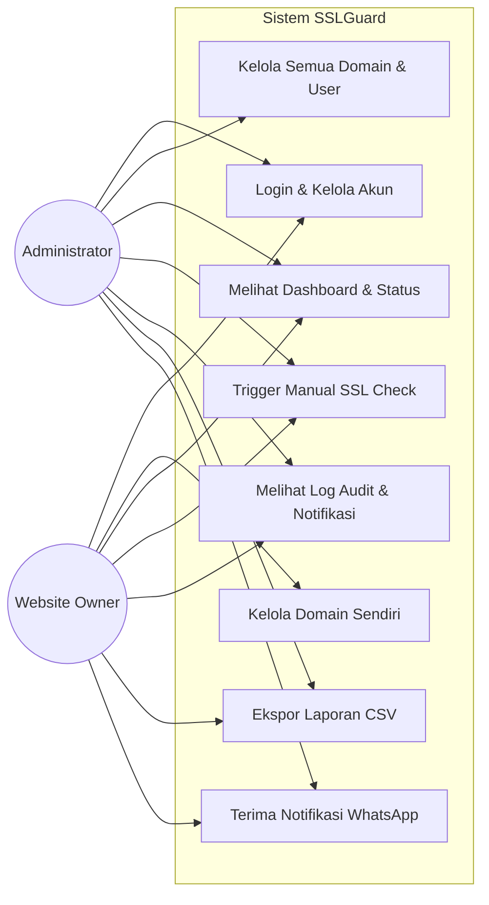
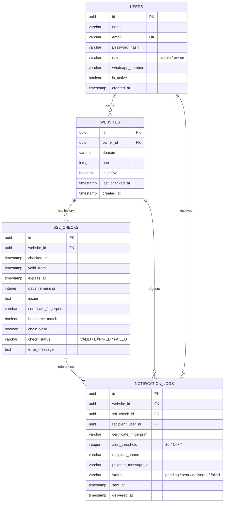
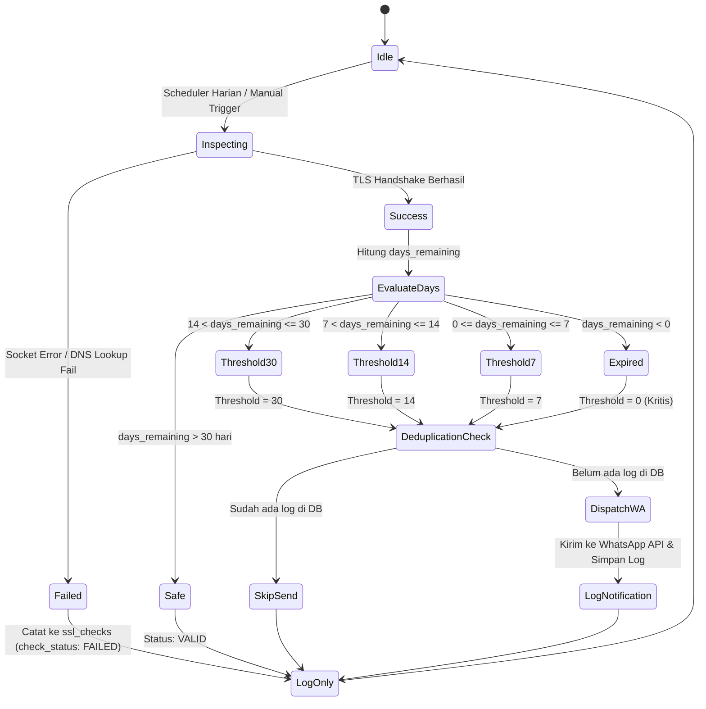

# SOFTWARE REQUIREMENTS SPECIFICATION (SRS)
## SISTEM SPESIFIKASI KEBUTUHAN PERANGKAT LUNAK (SKPL)
# **SSLGUARD: SSL Certificate Monitoring & WhatsApp Alert System**

**Nomor Dokumen:** SRS-SSLGUARD-2026-001  
**Versi:** 1.0  
**Tanggal:** Oktober 2026  
**Status:** Disetujui (Approved)  
**Penyusun:** Tim Pengembang PKL 2026 - KOMINFO  

---

## DAFTAR ISI
1. [PENDAHULUAN](#1-pendahuluan)
   - 1.1 Tujuan Penulisan Dokumen
   - 1.2 Ruang Lingkup Produk
   - 1.3 Definisi, Singkatan, dan Akronim
   - 1.4 Referensi
   - 1.5 Gambaran Umum Dokumen
2. [DESKRIPSI UMUM SISTEM](#2-deskripsi-umum-sistem)
   - 2.1 Perspektif Produk
   - 2.2 Ringkasan Fungsi Utama
   - 2.3 Karakteristik Pengguna dan Hak Akses
   - 2.4 Lingkungan Operasional
   - 2.5 Batasan Desain dan Implementasi
   - 2.6 Asumsi dan Ketergantungan
3. [KEBUTUHAN ANTARMUKA EKSTERNAL](#3-kebutuhan-antarmuka-eksternal)
   - 3.1 Antarmuka Pengguna (User Interface)
   - 3.2 Antarmuka Perangkat Keras (Hardware Interface)
   - 3.3 Antarmuka Perangkat Lunak (Software Interface)
   - 3.4 Antarmuka Komunikasi (Communication Interface)
4. [KEBUTUHAN FUNGSIONAL SISTEM (FUNCTIONAL REQUIREMENTS)](#4-kebutuhan-fungsional-sistem)
   - 4.1 Modul 1: Autentikasi dan Manajemen Pengguna
   - 4.2 Modul 2: Manajemen Website dan Domain
   - 4.3 Modul 3: SSL/TLS Inspection Engine (Pemeriksaan Sertifikat)
   - 4.4 Modul 4: Scheduled Monitoring & Task Engine
   - 4.5 Modul 5: Alert Evaluation & Anti-Spam Deduplication
   - 4.6 Modul 6: Layanan Notifikasi WhatsApp & Webhook
   - 4.7 Modul 7: Dashboard, Log Audit, dan Pelaporan
5. [KEBUTUHAN NON-FUNGSIONAL (NON-FUNCTIONAL REQUIREMENTS)](#5-kebutuhan-non-fungsional)
   - 5.1 Kinerja (Performance)
   - 5.2 Keamanan (Security & SSRF Mitigation)
   - 5.3 Keandalan dan Ketersediaan (Reliability & Availability)
   - 5.4 Kemudahan Pemeliharaan (Maintainability & Scalability)
6. [DIAGRAM MODEL ANALISIS & BASIS DATA](#6-diagram-model-analisis--basis-data)
   - 6.1 Use Case Diagram & Tabel Aktor
   - 6.2 Entity-Relationship Diagram (ERD) & Struktur Tabel
   - 6.3 State Transition / Alur Logika Evaluasi Peringatan
7. [MATRIKS KETERTELUSURAN (TRACEABILITY MATRIX)](#7-matriks-ketertelusuran)

---

## 1. PENDAHULUAN

### 1.1 Tujuan Penulisan Dokumen
Dokumen *Software Requirements Specification* (SRS) ini disusun untuk mendokumentasikan spesifikasi kebutuhan fungsional dan non-fungsional dari sistem **SSLGuard (SSL Certificate Monitoring & WhatsApp Alert System)**. Dokumen ini menjadi acuan kerja formal bagi:
1. Pengembang (*Developer*) dalam mengimplementasikan basis data, API *backend*, *SSL engine*, *scheduler*, dan *dashboard frontend*.
2. Penguji (*Quality Assurance/QA*) dalam menyusun skenario uji (*test case*) dan kriteria penerimaan sistem.
3. *Stakeholder* dan Pembimbing Instansi (KOMINFO) untuk memverifikasi kesesuaian sistem dengan permasalahan operasional yang dihadapi.

### 1.2 Ruang Lingkup Produk
**SSLGuard** adalah sistem perangkat lunak berbasis web yang bertugas memantau status masa berlaku (*expiration date*) dan integritas sertifikat keamanan digital (SSL/TLS) pada domain/subdomain website milik instansi atau pengguna.

#### Ruang Lingkup Termasuk:
- Manajemen domain/subdomain yang dipantau (port standar 443 atau port khusus).
- Mesin pemindaian sertifikat TLS publik menggunakan *handshake socket* aman.
- Pengujian parameter sertifikat: tanggal aktif (*valid_from*), tanggal kedaluwarsa (*expires_at*), sisa hari (*days_remaining*), nama penerbit (*issuer*), kecocokan hostname (*hostname match*), dan sidik jari sertifikat (*fingerprint*).
- Penjadwalan otomatis (*scheduler*) berbasis harian.
- Pengiriman notifikasi peringatan berjenjang via WhatsApp API resmi ke Admin dan Pemilik Website pada batas waktu **H-30**, **H-14**, dan **H-7**.
- Mekanisme deduplikasi/idempotensi untuk mencegah pengiriman pesan berulang (*spamming*).
- Dashboard analitik status domain, riwayat audit, dan ekspor laporan ke format CSV.

#### Di Luar Ruang Lingkup (Out of Scope):
- Perpanjangan sertifikat otomatis (*automatic certificate renewal/ACME protocol*).
- Pemindaian kerentanan aplikasi web (*Vulnerability Assessment / Penetration Testing*).
- Manajemen *Private Key* (sistem sama sekali tidak meminta dan tidak menyimpan *private key*).
- Pengawasan ketersediaan beban aplikasi (*Application Performance Monitoring / APM*).

### 1.3 Definisi, Singkatan, dan Akronim
| Istilah / Akronim | Penjelasan |
| :--- | :--- |
| **SSL / TLS** | *Secure Sockets Layer / Transport Layer Security*, protokol kriptografi untuk menyediakan komunikasi aman di internet. |
| **x509** | Standar format sertifikat kunci publik kriptografi internasional. |
| **Fingerprint** | Nilai *hash* unik (umumnya SHA-256) yang merepresentasikan identitas sebuah sertifikat SSL. |
| **SSRF** | *Server-Side Request Forgery*, serangan di mana penyerang mengeksploitasi fungsionalitas server untuk mengakses jaringan internal/privat. |
| **Idempotensi** | Sifat operasi di mana eksekusi berulang kali memberikan hasil yang sama tanpa menghasilkan efek samping ganda yang tidak diinginkan (mencegah duplikasi pesan). |
| **MVP** | *Minimum Viable Product*, versi produk dengan fitur esensial yang siap diuji dan digunakan. |
| **E.164** | Format standar internasional penomoran telepon (misal: `+6281234567890`). |

### 1.4 Referensi
1. RFC 5280: *Internet X.509 Public Key Infrastructure Certificate and Certificate Revocation List (CRL) Profile*.
2. IEEE Std 830-1998: *IEEE Recommended Practice for Software Requirements Specifications*.
3. Meta WhatsApp Business Management & Cloud API Documentation.
4. Dokumen Perancangan Sistem SSLGuard Versi 1.0 (Oktober 2026).

### 1.5 Gambaran Umum Dokumen
Dokumen ini disusun dalam 7 bab utama. Bab 2 menjelaskan perspektif umum produk, batasan, dan aktor. Bab 3 menjabarkan kebutuhan antarmuka. Bab 4 merinci seluruh kebutuhan fungsional (FR-01 s.d. FR-07). Bab 5 merinci kebutuhan non-fungsional (NFR). Bab 6 menyajikan model diagram use case, ERD, dan alur evaluasi, serta Bab 7 menyajikan matriks ketertelusuran kebutuhan.

---

## 2. DESKRIPSI UMUM SISTEM

### 2.1 Perspektif Produk
SSLGuard dirancang sebagai sistem independen (*self-hosted*) yang beroperasi di lingkungan server dengan konektivitas internet keluar (outbound HTTPS). Sistem berinteraksi dengan:
1. Target Web Server: Untuk melakukan TLS Handshake dan mengambil metadata sertifikat.
2. WhatsApp Cloud API: Untuk mendistribusikan notifikasi berbasis pesan instan.
3. Admin & Owner: Pengguna akhir yang mengakses antarmuka *dashboard* melalui peramban web modern.

```
+-------------------------------------------------------------------------------+
|                                  SSLGUARD                                     |
|  +-------------------+      +---------------------+      +-----------------+  |
|  | Web Dashboard UI  |<---->|   FastAPI Backend   |<---->| PostgreSQL DB   |  |
|  +-------------------+      +----------+----------+      +-----------------+  |
|                                        |                                      |
|                                        v                                      |
|                             +---------------------+                           |
|                             | Scheduler & Engines |                           |
|                             +-----+---------+-----+                           |
+-----------------------------------|---------|---------------------------------+
                                    |         |
                  Outbound TLS (443)|         | HTTPS REST API
                                    v         v
                         +-------------+   +----------------------+
                         | Target Web  |   | WhatsApp Cloud API / |
                         |   Domain    |   |    Provider WA       |
                         +-------------+   +----------------------+
```

### 2.2 Ringkasan Fungsi Utama
1. **Manajemen Akun:** Pendaftaran, login, dan manajemen profil dengan nomor WhatsApp terverifikasi.
2. **Manajemen Inventaris Domain:** Pencatatan nama domain, port, dan asosiasi pemilik (*owner*).
3. **Pemeriksaan SSL On-Demand & Terjadwal:** Eksekusi inspeksi langsung dari UI atau via cron harian.
4. **Analisis Integritas Sertifikat:** Perhitungan masa aktif, identifikasi penerbit (*CA*), dan kecocokan domain.
5. **Peringatan WhatsApp Multi-Kanal:** Pengiriman notifikasi pada ambang kritis H-30, H-14, dan H-7 secara terpisah untuk Admin dan Owner.
6. **Penyaringan Duplikasi (Deduplikasi):** Verifikasi riwayat sebelum pengiriman pesan agar tidak terjadi pengiriman berulang pada hari yang sama.
7. **Laporan & Audit:** Rekap riwayat pemeriksaan, kegagalan jaringan, log pengiriman WhatsApp, dan ekspor data ke CSV.

### 2.3 Karakteristik Pengguna dan Hak Akses
| Role | Deskripsi Pengguna | Hak Akses Utama |
| :--- | :--- | :--- |
| **Administrator** | Tim IT/DevOps/Security yang mengelola infrastruktur pusat. | - Melihat dan mengelola seluruh website di sistem.<br>- Mengelola akun seluruh pengguna.<br>- Mengatur parameter scheduler & konfigurasi WhatsApp API.<br>- Menjalankan pemeriksaan manual untuk domain apapun.<br>- Menerima tembusan seluruh notifikasi kedaluwarsa domain. |
| **Website Owner** | Unit kerja/pemilik layanan website tertentu. | - Mendaftarkan dan memodifikasi domain milik unitnya sendiri.<br>- Melihat riwayat pemeriksaan dan status masa berlaku domain miliknya.<br>- Menerima notifikasi WhatsApp terkait domain miliknya.<br>- Tidak dapat melihat domain atau log milik unit kerja lain. |

### 2.4 Lingkungan Operasional
- **Sistem Operasi Server:** Linux (Ubuntu 22.04 LTS atau lebih baru) / Windows Server.
- **Runtime Backend:** Python 3.10+ (Framework FastAPI, Uvicorn ASGI).
- **Basis Data:** PostgreSQL 14+.
- **Antarmuka Peramban:** Google Chrome, Mozilla Firefox, Microsoft Edge, Safari versi terbaru.
- **Jaringan:** Membutuhkan akses outbound TCP Port 443 (TLS) dan Port 80/443 (REST API WhatsApp).

### 2.5 Batasan Desain dan Implementasi
1. Sistem hanya memproses data sertifikat publik x509 yang diperoleh melalui protokol TLS.
2. WhatsApp API tunduk pada aturan *template message* dan biaya/kebijakan perpesanan resmi Meta.
3. Timeout koneksi SSL dibatasi maksimal 10 detik per domain untuk mencegah *starvation* pada scheduler.
4. Hostname yang dituju wajib lolos proteksi filter SSRF (tidak boleh mengarah ke IP privat atau *loopback*).

### 2.6 Asumsi dan Ketergantungan
1. Server memiliki koneksi internet publik yang stabil dan resolver DNS yang valid.
2. Domain target dapat diakses dari jaringan publik pada port yang ditentukan (default 443).
3. Akun WhatsApp Business API memiliki saldo/kuota pengiriman yang aktif.

---

## 3. KEBUTUHAN ANTARMUKA EKSTERNAL

### 3.1 Antarmuka Pengguna (User Interface)
- Antarmuka berupa aplikasi web responsif (desktop dan mobile-friendly).
- Halaman Utama (Dashboard): Widget ringkasan status (Total Domain, Valid, Warning H-30/14/7, Expired, Failed).
- Halaman Manajemen Website: Tabel interaktif dengan pencarian, filter status, tombol *Manual Check*, dan modal tambah/edit domain.
- Halaman Detail Website: Riwayat time-series pemeriksaan, informasi lengkap x509 (Issuer, Serial Number, Fingerprint).
- Halaman Log Notifikasi: Tabel audit pesan (penerima, status delivery, timestamp, payload template).

### 3.2 Antarmuka Perangkat Keras (Hardware Interface)
Tidak ada perangkat keras khusus. Sistem beroperasi pada server berbasis komputasi umum (Virtual Machine, Cloud Instance, atau Bare-Metal Server) dengan spesifikasi minimal:
- 1 vCPU / Dual Core
- 2 GB RAM
- 20 GB SSD Storage

### 3.3 Antarmuka Perangkat Lunak (Software Interface)
1. **Database PostgreSQL:** Terhubung melalui driver async/sync Python (SQLAlchemy / asyncpg / psycopg2) menggunakan koneksi terenkripsi.
2. **WhatsApp Business Platform Cloud API:** Mengirimkan permintaan HTTP POST dengan format payload JSON menggunakan otentikasi Bearer Token.
3. **Pustaka Kriptografi Python:** Menggunakan modul standar `ssl`, `socket`, dan pustaka pihak ketiga `cryptography` (PyCA).

### 3.4 Antarmuka Komunikasi (Communication Interface)
- **HTTPS (Port 443):** Komunikasi aman untuk antarmuka web dan seluruh panggilan REST API.
- **TCP TLS Handshake:** Pengambilan sertifikat SSL dari server target.
- **Webhook Endpoint (HTTPS POST):** Menerima status pengiriman pesan dari provider WhatsApp (*delivered*, *read*, *failed*).

---

## 4. KEBUTUHAN FUNGSIONAL SISTEM

### 4.1 Modul 1: Autentikasi dan Manajemen Pengguna
| Kode Kebutuhan | Deskripsi Kebutuhan | Aturan Bisnis & Validasi |
| :--- | :--- | :--- |
| **FR-AUTH-01** | Sistem harus menyediakan fitur login berbasis email dan kata sandi. | Kata sandi diverifikasi terhadap *hash* (menggunakan algoritma Argon2 / Bcrypt). |
| **FR-AUTH-02** | Sistem harus menghasilkan token otentikasi berbasis JSON Web Token (JWT) yang memiliki masa berlaku. | Token dikirimkan dalam header `Authorization: Bearer <token>` pada setiap request terproteksi. |
| **FR-AUTH-03** | Sistem harus menerapkan kontrol akses berbasis peran (*Role-Based Access Control / RBAC*). | Pengguna dikelompokkan ke dalam peran `admin` atau `owner`. |
| **FR-AUTH-04** | Admin dapat menambah, mengubah, dan menonaktifkan akun pengguna. | Nomor telepon pengguna wajib divalidasi ke format internasional standar E.164 (misal: `+62...`). |

### 4.2 Modul 2: Manajemen Website dan Domain
| Kode Kebutuhan | Deskripsi Kebutuhan | Aturan Bisnis & Validasi |
| :--- | :--- | :--- |
| **FR-DOM-01** | Pengguna dapat mendaftarkan domain baru untuk dipantau. | Input: Nama domain (FQDN, misal `layanan.kotakab.go.id`) dan port (default 443). |
| **FR-DOM-02** | Sistem harus memvalidasi format nama domain dan mencegah serangan SSRF. | Domain tidak boleh berupa IP privat (`10.x.x.x`, `192.168.x.x`, `127.0.0.1`, `169.254.x.x`) atau hostname `localhost`. |
| **FR-DOM-03** | Pengguna dengan peran `owner` hanya dapat melihat dan mengelola domain yang berada di bawah kepemilikannya. | Filter query `owner_id == current_user.id` diterapkan otomatis pada level backend. |
| **FR-DOM-04** | Pengguna dapat mengaktifkan atau menonaktifkan status pemantauan (*active/inactive*) suatu domain. | Domain yang berstatus `inactive` akan diabaikan oleh mesin scheduler harian. |

### 4.3 Modul 3: SSL/TLS Inspection Engine
| Kode Kebutuhan | Deskripsi Kebutuhan | Aturan Bisnis & Validasi |
| :--- | :--- | :--- |
| **FR-SSL-01** | Sistem dapat melakukan pemeriksaan sertifikat SSL/TLS terhadap domain dan port yang ditentukan. | Membuka koneksi TLS handshake menggunakan SNI (*Server Name Indication*). Timeout koneksi ditetapkan 10 detik. |
| **FR-SSL-02** | Sistem harus mengekstraksi metadata sertifikat publik x509. | Data yang diekstrak: `valid_from`, `expires_at`, `issuer` (Organisasi & Common Name), `subject`, `san` (Subject Alternative Names), dan `sha256_fingerprint`. |
| **FR-SSL-03** | Sistem harus menghitung sisa masa berlaku sertifikat dalam satuan hari. | Perhitungan: `days_remaining = (expires_at - now_utc).days`. |
| **FR-SSL-04** | Sistem harus memvalidasi kecocokan nama host (*hostname match*). | Memeriksa apakah domain yang diminta cocok dengan *Common Name* atau salah satu entri dalam *Subject Alternative Name* (SAN) sertifikat. |
| **FR-SSL-05** | Sistem harus membedakan secara tegas antara sertifikat bermasalah dengan kegagalan koneksi jaringan. | - Kegagalan DNS atau Timeout dicatat sebagai status `FAILED` dengan keterangan `error_message`.<br>- Sertifikat kedaluwarsa dicatat sebagai `EXPIRED`.<br>- Sertifikat aktif dan valid dicatat sebagai `VALID`. |
| **FR-SSL-06** | Pengguna dapat memicu pemeriksaan manual (*On-Demand Check*) melalui tombol di dashboard. | Sistem menyediakan proteksi *rate-limiting* (maksimal 1 pemeriksaan manual per domain setiap 1 menit). |

### 4.4 Modul 4: Scheduled Monitoring & Task Engine
| Kode Kebutuhan | Deskripsi Kebutuhan | Aturan Bisnis & Validasi |
| :--- | :--- | :--- |
| **FR-SCH-01** | Sistem harus menjalankan tugas pemeriksaan otomatis harian pada jadwal yang telah dikonfigurasi (misal pukul 07:00 WIB). | Menggunakan APScheduler yang mengambil seluruh daftar domain dengan `is_active = true`. |
| **FR-SCH-02** | Setiap hasil eksekusi pemeriksaan wajib disimpan ke tabel `ssl_checks` sebagai data time-series. | Menyimpan snapshot riwayat tanggal periksa, sisa hari, dan status untuk kebutuhan audit. |
| **FR-SCH-03** | Sistem harus memperbarui kolom `last_checked_at` pada tabel `websites` setelah pemeriksaan selesai. | Menjadi penanda audit terakhir kali domain berhasil diinspeksi. |

### 4.5 Modul 5: Alert Evaluation & Anti-Spam Deduplication
| Kode Kebutuhan | Deskripsi Kebutuhan | Aturan Bisnis & Validasi |
| :--- | :--- | :--- |
| **FR-ALT-01** | Sistem harus mengevaluasi status sisa hari terhadap tiga ambang batas (*threshold*): H-30, H-14, dan H-7. | - Sisa hari <= 30 dan > 14: Kategori Ambang 30.<br>- Sisa hari <= 14 dan > 7: Kategori Ambang 14.<br>- Sisa hari <= 7: Kategori Ambang 7. |
| **FR-ALT-02** | Sistem wajib menerapkan aturan idempotensi/deduplikasi sebelum membuat antrean pesan notifikasi. | Sistem memeriksa apakah sudah ada log pengiriman berhasil pada tabel `notification_logs` dengan kunci identik: `(website_id, certificate_fingerprint, alert_threshold, recipient_user_id)`. |
| **FR-ALT-03** | Jika sertifikat domain diperbarui (*renewed*), sistem harus otomatis menginisialisasi siklus peringatan baru. | Perubahan sertifikat terdeteksi melalui perubahan `certificate_fingerprint`. |
| **FR-ALT-04** | Sistem tidak boleh mengirim peringatan kedaluwarsa jika status pemeriksaan terakhir adalah `FAILED` (gangguan jaringan/DNS). | Mencegah *false alarm* kepada pengguna saat server target hanya mengalami *down* sementara. |

### 4.6 Modul 6: Layanan Notifikasi WhatsApp & Webhook
| Kode Kebutuhan | Deskripsi Kebutuhan | Aturan Bisnis & Validasi |
| :--- | :--- | :--- |
| **FR-NOT-01** | Sistem harus mendistribusikan notifikasi secara terpisah kepada Pemilik Domain (*Owner*) dan Administrator. | Setiap penerima memiliki nomor telepon dan log pengiriman independen. |
| **FR-NOT-02** | Pesan WhatsApp yang dikirim harus menggunakan template resmi yang terdaftar. | Parameter template mencakup: Nama Pengguna, Nama Domain, Status, Sisa Hari, dan Tanggal Kedaluwarsa. |
| **FR-NOT-03** | Sistem harus mencatat ID pesan dari provider (*provider_message_id*) dan status awal (*sent/pending*). | Disimpan di tabel `notification_logs` untuk pelacakan. |
| **FR-NOT-04** | Sistem harus menyediakan endpoint Webhook untuk menerima callback status pesan dari provider WhatsApp. | Memperbarui kolom `status` menjadi `delivered` atau `failed` serta mencatat `delivered_at`. |
| **FR-NOT-05** | Sistem harus menerapkan mekanisme *retry* terbatas (maksimal 3 kali percobaan) jika pengiriman ke provider WhatsApp mengalami kegagalan teknis sementara (*HTTP 5xx*). | Interval percobaan ulang menggunakan *exponential backoff*. |

### 4.7 Modul 7: Dashboard, Log Audit, dan Pelaporan
| Kode Kebutuhan | Deskripsi Kebutuhan | Aturan Bisnis & Validasi |
| :--- | :--- | :--- |
| **FR-REP-01** | Sistem harus menampilkan ringkasan data statistik di halaman muka dashboard. | Menampilkan jumlah website dipantau, jumlah sertifikat valid, sertifikat masa peringatan (H-30/14/7), dan sertifikat gagal periksa. |
| **FR-REP-02** | Pengguna dapat melakukan penyaringan (*filter*) dan pencarian (*search*) pada daftar website. | Filter berdasarkan: Status (Valid, Expiring Soon, Expired, Failed) dan Pemilik Website (khusus Admin). |
| **FR-REP-03** | Pengguna dapat melihat riwayat lengkap pemeriksaan (*SSL Check History*) dari suatu website. | Disajikan dalam bentuk tabel urut waktu terbaru (*chronological order*). |
| **FR-REP-04** | Pengguna dapat melihat log riwayat pengiriman notifikasi WhatsApp. | Menampilkan waktu kirim, nama domain, nomor tujuan, ambang hari, dan status pengiriman. |
| **FR-REP-05** | Sistem harus menyediakan fitur ekspor data hasil monitoring ke dalam format berkas CSV. | Berkas CSV memuat kolom: Domain, Port, Owner, Status, Masa Berlaku, Sisa Hari, Penerbit, dan Terakhir Diperiksa. |

---

## 5. KEBUTUHAN NON-FUNGSIONAL

### 5.1 Kinerja (Performance)
- **NFR-PERF-01:** Waktu respons endpoint REST API (di luar proses pengecekan SSL real-time) tidak boleh melebihi 500 milidetik pada beban normal.
- **NFR-PERF-02:** Pemeriksaan manual SSL per domain harus menyelesaikan proses handshake dan parsing sertifikat dalam waktu kurang dari 5 detik untuk server dengan konektivitas normal.
- **NFR-PERF-03:** Scheduler harian harus mendukung pemrosesan asinkron/paralel (menggunakan thread pool atau async task) sehingga mampu memeriksa 100 domain dalam waktu kurang dari 5 menit.

### 5.2 Keamanan (Security)
- **NFR-SEC-01 (Pencegahan SSRF):** Sistem backend wajib melakukan resolusi DNS dan memvalidasi alamat IP target sebelum membuka koneksi socket. Akses ke rentang IP berikut wajib diblokir:
  - `127.0.0.0/8` (Loopback)
  - `10.0.0.0/8`, `172.16.0.0/12`, `192.168.0.0/16` (Private IPv4)
  - `169.254.0.0/16` (Link-Local / AWS & Cloud Metadata IP)
  - `::1` dan rentang IPv6 lokal.
- **NFR-SEC-02 (Kerahasiaan Kredensial):** Kata sandi pengguna wajib di-*hash* menggunakan algoritma kuat (Bcrypt/Argon2). API Key, Database URL, dan Token WhatsApp API wajib disimpan dalam variabel lingkungan (*environment variables* / `.env`) dan tidak boleh di-*hardcode*.
- **NFR-SEC-03 (Proteksi Transport):** Seluruh komunikasi antara peramban klien dan server SSLGuard wajib menggunakan protokol HTTPS terenkripsi.
- **NFR-SEC-04 (Zero Private Key Exposure):** Sistem dirancang tanpa pernah meminta, membaca, maupun menyimpan *private key* SSL. Sistem hanya berinteraksi dengan sertifikat publik x509 yang terbuka untuk umum.

### 5.3 Keandalan dan Ketersediaan (Reliability & Availability)
- **NFR-REL-01:** Sistem memiliki tingkat ketersediaan layanan (*uptime*) minimal 99% dalam kondisi operasional normal.
- **NFR-REL-02:** Jika terjadi kegagalan jaringan saat scheduler berjalan, kegagalan tersebut harus ditangani secara elegan (*graceful exception handling*) tanpa menghentikan pemrosesan domain lainnya.

### 5.4 Kemudahan Pemeliharaan (Maintainability & Scalability)
- **NFR-MNT-01:** Kode program backend ditulis secara modular dengan pemisahan lapisan yang jelas (*separation of concerns*): Routing API, Layanan Bisnis (*Services*), Model Data (*ORM*), dan Skema Validasi (*Pydantic*).
- **NFR-MNT-02:** Seluruh perubahan skema basis data wajib dikelola menggunakan sistem migrasi database otomatis (Alembic).

---

## 6. DIAGRAM MODEL ANALISIS & BASIS DATA

### 6.1 Use Case Diagram & Tabel Aktor



### 6.2 Entity-Relationship Diagram (ERD) & Struktur Tabel



#### Aturan Kunci Integritas Data (Constraints):
- **Unique Constraint pada `notification_logs`:**
  `UNIQUE (website_id, certificate_fingerprint, alert_threshold, recipient_user_id)`
  *Tujuan:* Menjamin secara fisik di level database bahwa satu siklus sertifikat tidak akan pernah mengirimkan peringatan ganda untuk ambang hari yang sama kepada orang yang sama.

### 6.3 State Transition / Alur Logika Evaluasi Peringatan



---

## 7. MATRIKS KETERTELUSURAN (TRACEABILITY MATRIX)

| ID Kebutuhan Fungsional | Deskripsi Singkat | Use Case Terkait | Tabel Basis Data Terkait | Modul Pengujian / QA |
| :--- | :--- | :--- | :--- | :--- |
| **FR-AUTH-01 s.d. 04** | Login, JWT & Role Admin/Owner | UC1, UC3 | `users` | Test Auth & RBAC |
| **FR-DOM-01 s.d. 04** | CRUD Domain & Proteksi SSRF | UC2, UC3 | `websites`, `users` | Test Domain CRUD & SSRF |
| **FR-SSL-01 s.d. 06** | Engine x509, Hostname & Manual Check | UC5 | `ssl_checks`, `websites` | Test TLS Socket & Parser |
| **FR-SCH-01 s.d. 03** | Scheduler Otomatis Harian | Sistem Otomatis | `websites`, `ssl_checks` | Test APScheduler Runner |
| **FR-ALT-01 s.d. 04** | Evaluasi Ambang & Deduplikasi | Sistem Otomatis | `notification_logs` | Test Alert Logic & Deduplication |
| **FR-NOT-01 s.d. 05** | Integrasi WhatsApp API & Webhook | UC8 | `notification_logs`, `users` | Test WhatsApp Mock & Provider |
| **FR-REP-01 s.d. 05** | Dashboard, Riwayat & Ekspor CSV | UC4, UC6, UC7 | Seluruh Tabel | Test UI, Filter & Export CSV |

---
**Disetujui Oleh:**  
Pembimbing Lapangan / Penanggung Jawab Teknis PKL  
KOMINFO - 2026
